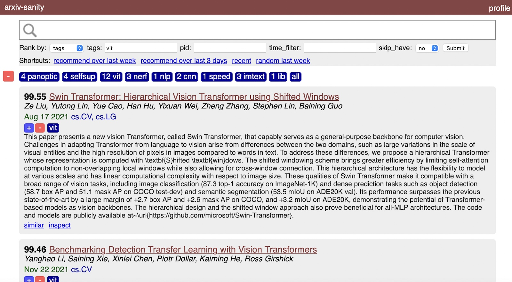

# arxiv-sanity-lite

This repository is based on [karpathy/arxiv-sanity-lite](https://github.com/karpathy/arxiv-sanity-lite) (commit d7a303b), which replaced the older arxiv-sanity-preserver code. The goal of this fork is to add features for sourcing researchers by keyword.

#### Search syntax

Terms match whole words, ignoring case and accents, and plurals match too. Papers are ranked by how many terms match, with title matches weighted most, then authors, then the abstract.

- `diffusion` a plain term (`rl` will not match "world")
- `"graph neural network"` an exact phrase
- `learn*` a prefix: learn, learning, learned, ...
- `+robotics` required, `-survey` excluded
- `au:hinton`, `ti:transformer`, `abs:benchmark` restrict a term to the authors, title or abstract

These combine, e.g. `+au:"yann lecun" "self-supervised" -ti:survey`. The same help is on the site's About page.

#### Deploying on Vercel

Locally everything is stored in files under `data/`. When the `DATABASE_URL` environment variable is set, all state (papers, tags, features) lives in that Postgres database instead, which is what makes the site work on Vercel, whose filesystem does not persist. The pieces:

1. **Database.** Create a Postgres database, e.g. a new [Neon](https://neon.tech) project, and copy its connection string. The tables are created automatically on first use.
2. **Paper updates.** `.github/workflows/update.yml` runs `arxiv_daemon.py` and `compute.py` daily on GitHub Actions. Add the connection string as the repository secret `DATABASE_URL` (Settings → Secrets and variables → Actions). For the first fill, run the workflow by hand (Actions → update papers → Run workflow) with a larger number, e.g. 10000.
3. **Web app.** Import this repository as a new Vercel project (Vercel detects Flask, and `pyproject.toml` tells it the app is `serve:app`) and set these environment variables:
   - `DATABASE_URL`: the same connection string (Neon's pooled one is best here)
   - `SECRET_KEY`: a long random string, e.g. from `python -c "import secrets; print(secrets.token_urlsafe(32))"`
   - `SITE_PASSWORD`: a password for the whole site. Logins are username-only, so without this anyone with the URL can see and change your tags.

Static files are in `public/static`, which Vercel serves from its CDN. Paper thumbnails (`thumb_daemon.py`) only work when running locally.

A much lighter-weight arxiv-sanity from-scratch re-write. Periodically polls arxiv API for new papers. Then allows users to tag papers of interest, and recommends new papers for each tag based on SVMs over tfidf features of paper abstracts. Allows one to search, rank, sort, slice and dice these results in a pretty web UI. Lastly, arxiv-sanity-lite can send you daily emails with recommendations of new papers based on your tags. Curate your tags, track recent papers in your area, and don't miss out!

I am running a live version of this code on [arxiv-sanity-lite.com](https://arxiv-sanity-lite.com).



#### To run

To run this locally I usually run the following script to update the database with any new papers. I typically schedule this via a periodic cron job:

```bash
#!/bin/bash

python3 arxiv_daemon.py --num 2000

if [ $? -eq 0 ]; then
    echo "New papers detected! Running compute.py"
    python3 compute.py
else
    echo "No new papers were added, skipping feature computation"
fi
```

You can see that updating the database is a matter of first downloading the new papers via the arxiv api using `arxiv_daemon.py`, and then running `compute.py` to compute the tfidf features of the papers. Finally to serve the flask server locally we'd run something like:

```bash
export FLASK_APP=serve.py; flask run
```

All of the database will be stored inside the `data` directory. Finally, if you'd like to run your own instance on the interwebs I recommend simply running the above on a [Linode](https://www.linode.com), e.g. I am running this code currently on the smallest "Nanode 1 GB" instance indexing about 30K papers, which costs $5/month.

(Optional) Finally, if you'd like to send periodic emails to users about new papers, see the `send_emails.py` script. You'll also have to `pip install sendgrid`. I run this script in a daily cron job.

#### Requirements

 Install via requirements:

 ```bash
 pip install -r requirements.txt
 ```

#### Todos

- Make website mobile friendly with media queries in css etc
- The metas table should not be a sqlitedict but a proper sqlite table, for efficiency
- Build a reverse index to support faster search, right now we iterate through the entire database

#### License

MIT
